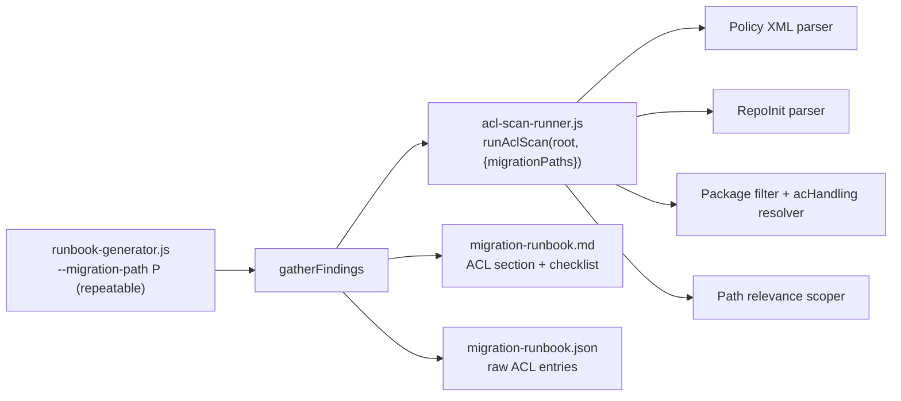

# ACL-aware migration runbook — design

**Status:** Draft for user review
**Date:** 2026-11-17
**Skill:** `plugins/aem/cloud-service/skills/migration` (Step 0 runbook)
**Intended repo path:** `docs/superpowers/specs/2026-11-17-acl-migration-runbook-design.md`

## 1. Intent

### What the user asked for

> "can you create a plan since u have understood the repo customer like cox can you add support in skills"

Context from the preceding work: content migrations to AEM as a Cloud Service can
silently lose permissions. A migration set such as `/content/abc` may depend on an
ACL defined on an ancestor (for example `/content/rep:policy`), and the groups that
ACL references may never be migrated. Customer code also ships ACLs, but shipping an
ACL file does not mean the package imports it, and an imported ACL does not prove
effective access.

### Confirmed design decisions

- A **read-only code scan**, integrated into the existing `migration-runbook.md`
  (Step 0). No separate tool.
- Scan `_rep_policy.xml` files and RepoInit ACL statements that are **relevant to the
  selected migration path(s) and their ancestors**.
- Preserve and report **principals, allow/deny, privileges and restrictions**.
- Assess the **package filter** and **ACL handling** (`acHandling`) when they can be
  determined.
- **Unknown or ambiguous input stays `unknown`, never clean.**
- The runbook tells the customer to **verify source JCR ACLs**, **review the intended
  permissions**, and **validate access after migration**.
- **No automatic ACL changes and no JCR connection.**

### Motivating examples (local customer checkouts, not deployed state)

- **Cox:** `content/src/main/content/jcr_root/etc/cox/lists/address-serviceability-status/_rep_policy.xml`
  grants `content-admin` access with a `rep:glob` restriction. The module's
  `META-INF/vault/filter.xml` does **not** include that path, so the ACL cannot be
  assumed to be imported.
- **Signify:** `jcr_root/content/experience-fragments/_rep_policy.xml` defines an ACL on
  the parent `/content/experience-fragments`, and the package filter includes it. A
  separate RepoInit ACL targets a service user.

### Success criteria

1. For a given migration path, the runbook lists every ACL entry found in code on
   that path, its ancestors, or its descendants. Each entry shows the principal,
   allow/deny, privileges and restrictions, in source order.
2. A Cox-shaped input reports the entry together with `filter: not-covered` and
   `import: not-eligible-for-acl-import`. It is never reported as clean.
3. A file the scanner cannot parse confidently appears as an `unknown` entry. It is
   never dropped.
4. The ACL section always includes the customer checklist, even when no ACL is
   found in code.
5. All other runbook patterns behave exactly as before.

## 2. Approaches considered

| Option | Summary | Verdict |
|---|---|---|
| **A. New runbook pattern `aclPermissions` + `acl-scan-runner.js`** | Same shape as `osgi-config-runner.js` / `vault-package-scan-runner.js`; wired into `gatherFindings`, rendered with the other patterns, cached in `migration-runbook.json`. | **Chosen.** Matches the confirmed "integrated into the existing runbook" decision and existing conventions. |
| B. Standalone `acl-report.js` writing its own markdown | Simpler to isolate, but a second artifact and a second command the agent must remember. | Rejected: not integrated. |
| C. SKILL.md guidance only (agent greps by hand) | No code, but non-deterministic and impossible to test. | Rejected: makes "unknown ≠ clean" unenforceable. |

## 3. Architecture



### 3.1 New pattern in `PATTERN_META`

```js
aclPermissions: {
  label: 'ACLs / Permissions for Migrated Content',
  severity: 'high',
  strategy: 'acl-scan',
  bpaSlugs: [],          // no BPA subtype — code-only scan
  heuristic: true,
  alwaysRender: true,    // section + checklist rendered even with zero findings
  description: 'Access-control entries defined in code (`_rep_policy.xml`, inline `rep:policy`, RepoInit `set ACL`) on the migration path, its ancestors and descendants — principals, allow/deny, privileges and restrictions, with a conservative package-filter / acHandling import-eligibility label. Code shows intended ACLs only; the source JCR is the source of truth, and ancestor ACEs are potentially relevant, not proof of effective access. Review-only: nothing is changed.',
  promptPattern: 'acl review',
  sampleOverride: 'Use the migration skill: explain the ACL findings in my migration runbook and what I must verify in the source and target repositories.',
  checklist: [ /* §5 */ ],
}
```

`SOURCE_LABEL['acl-scan'] = 'ACL scan'`.

### 3.2 New module `scripts/acl-scan-runner.js`

Zero-dependency Node module. It uses the same walk and skip-list (`node_modules`,
`.git`, `target`, `dist`) as `legacy-ui-runner.js` and `osgi-config-runner.js`.

```js
runAclScan(workspaceRoot, { migrationPaths = [] } = {})
  → { ok, findings, rawFindings, warnings, error? }
```

The module contains four internal units. Each one is exported for tests.

| Unit | Responsibility | Input → output |
|---|---|---|
| `parsePolicyXml(text)` | Parse `rep:ACL` / `rep:GrantACE` / `rep:DenyACE` nodes from FileVault docview XML. | XML string → `{ entries: AceEntry[], unknown: string[] }` |
| `parseRepoInit(text)` | Extract ACL statements from RepoInit scripts. | script text → `{ entries: AceEntry[], unknown: {line, text}[] }` |
| `resolvePackage(fileAbs, policyPath)` | Find the owning content package and evaluate filter coverage and `acHandling`. | → `{ filterStatus, acHandling, importVerdict, packageRoot }` |
| `relationTo(policyPath, migrationPaths)` | Classify the policy path against the migration paths. | → `{ relation, matchedPaths }`, where `relation` is `'self' \| 'ancestor' \| 'descendant' \| 'unrelated' \| 'unscoped'` |

### 3.3 Generator changes (`runbook-generator.js`)

- New option `migrationPaths: string[]` on `gatherFindings` and `generateRunbook`.
  New CLI flag `--migration-path <jcrPath>`, which can be repeated.
- New `acl-scan` block in `gatherFindings`. It sits next to the `config-scan` and
  `pom-scan` blocks and follows the same pattern: on `ok`, set the findings and
  `sourceByPattern = 'acl-scan'`; always propagate `warnings`. On a deterministic
  scanner failure (`ok: false`, or a partial scan with unreadable inputs) the
  pattern gets an explicit `scanStatus: 'incomplete'` (see §7). It is listed in
  `needsLlmScan` as today, but an LLM fallback **never** clears that status: merged
  LLM findings are added alongside it, and the section and summary keep showing
  `incomplete — verify in JCR`.
- Invalid explicit `--migration-path` values make the CLI fail. See §7.
- `renderRunbook`: a pattern with `alwaysRender` is rendered even when it has zero
  findings, and is **never** listed under "Scanned — no findings". The pattern
  section also renders `meta.checklist` (see §5).
- `writeRunbookCache`: also writes top-level `migrationPaths`. ACL raw entries keep
  their extra fields.
- The CLI prints `Migration paths:` when the option is supplied.

## 4. Detection rules

### 4.1 Inputs scanned

1. **`_rep_policy.xml`** under any `jcr_root/`. The owning node path comes from the
   path relative to `jcr_root`. FileVault names are decoded (`_ns_name` → `ns:name`
   and `%xx` percent-escapes). Example: `jcr_root/etc/cox/lists/x/_rep_policy.xml`
   → policy on `/etc/cox/lists/x`.
2. **Inline `rep:policy` children** inside a `.content.xml` under `jcr_root/`. These
   are elements named `rep:policy` with `jcr:primaryType="rep:ACL"`.
3. **RepoInit**:
   - OSGi configs whose PID is
     `org.apache.sling.jcr.repoinit.RepositoryInitializer` followed by a factory
     instance separator, either the current `~` form or the legacy `-` form
     (`RepositoryInitializer~name`, `RepositoryInitializer-name`), plus the bare
     PID. Supported formats are `.cfg.json`, `.config` and `.cfg`; the `scripts`
     value is used. File names are matched exactly on the PID and then the
     separator, so unrelated PIDs that merely start with the same text are not
     matched.
   - Script files referenced by `references`, when they resolve inside the workspace.
   - The run-mode folder (for example `config.author`) is recorded on each entry.

Out of scope (see §8): `rep:repoPolicy`, `rep:cugPolicy`, principal-based
authorization nodes, and policies inside dependency packages that are not in the
workspace.

### 4.2 ACE model (`AceEntry`)

```js
{
  kind: 'acl-entry' | 'acl-unknown',
  sourceType: 'policy-xml' | 'inline-policy' | 'repoinit',
  file, line,                     // workspace-relative in the cache
  policyPath,                     // JCR node owning the ACL ('/content/x'); null if unresolved
  order,                          // ACE index within its ACL (order matters)
  effect: 'allow' | 'deny',
  principals: string[],
  privileges: string[],
  restrictions: { [name]: string[] },   // rep:glob, rep:ntNames, rep:itemNames, rep:prefixes, …
  runmode: string | null,               // RepoInit only
  relation, matchedPaths,               // §4.3
  filterStatus, acHandling, importVerdict,  // §4.4
  status: 'parsed' | 'unknown',
  reason: string | null,                // why an entry is unknown
}
```

Parsing rules:

- XML privileges `{Name}[jcr:read,rep:write]` → `['jcr:read','rep:write']`.
- Restrictions can be ACE attributes (legacy `rep:glob`) or children of
  `rep:restrictions`. Both forms are merged by name, and values are kept verbatim.
  ACL restriction values are not secrets, unlike OSGi values.
- An ACE element is reported as `acl-unknown` when it has an unexpected type, is
  missing `rep:principalName` or `rep:privileges`, or has a value the parser can't
  decode. A file the tokenizer can't read at all produces one `acl-unknown` entry for
  that file, plus a warning.
- RepoInit: parse both `set ACL for <principals> … end` and
  `set ACL on <paths> … end`, including the `allow|deny <privs> [on <paths>]
  [for <principals>] [restriction(name, values…)]` lines in each block. A statement
  that targets several paths produces one entry per path. For
  `set principal ACL` blocks, and for any line inside an ACL block that the parser
  doesn't recognize (for example `home(...)`, `:repository`, or `remove`), emit an
  `acl-unknown` entry with the original text and line number.

### 4.3 Migration-path scoping

`migrationPaths` are normalized absolute JCR paths with no trailing slash. For each
entry with a `policyPath`, the scoper compares it with every migration path P:

- `self`: `policyPath === P`
- `ancestor`: `policyPath` is a proper ancestor of P, so its ACEs are
  **potentially relevant** to the migrated content through inheritance. `/` counts
  as an ancestor. This is **not proof of effective access**: restrictions (for
  example a `rep:glob` that does not match P), other policies on the path, ACE
  order, deny entries, and group memberships all affect the result and can only be
  confirmed by runtime validation in the target environment.
- `descendant`: `policyPath` is under P.
- `unrelated`: none of the above. These entries are **excluded** from the runbook
  and counted in a warning ("N ACL entries outside the migration paths were
  skipped").

If an entry matches more than one P, the closest relation wins
(`self` > `ancestor` > `descendant`), and every matching P goes into
`matchedPaths`. `acl-unknown` entries with `policyPath === null` are always kept.

If no `--migration-path` is given, every entry is `unscoped`. A warning explains
that inheritance relevance was not assessed and lists the flag to use.

### 4.4 Deployability (filter + acHandling)

`resolvePackage` walks up from the file to the nearest directory that contains
`jcr_root/` and `META-INF/vault/`.

**Filter coverage.** The scanner checks whether `<policyPath>/rep:policy` is covered
by `META-INF/vault/filter.xml`. A filter root that is the path itself or an ancestor
must match. `include`/`exclude` rules are evaluated in order, and the last match wins.
The default is set by the first rule's type, following FileVault semantics.

- `covered` or `not-covered` when the filter is present and parsed.
- `unknown` when there is no `filter.xml` in source (it may be generated by the build
  from the pom's `<filters>`), the XML can't be parsed, or a pattern isn't a valid
  regex.

**acHandling.** Sources are checked in this order:

1. `META-INF/vault/properties.xml` key `acHandling`.
2. The module `pom.xml` `filevault-package-maven-plugin` / `content-package-maven-plugin`
   configuration (`<accessControlHandling>` or `<properties><acHandling>`). This is a
   raw text scan, like the `vault-package-scan-runner` fallback.

The value is one of `ignore | overwrite | merge | merge_preserve | clear | not-set | unknown`.
`not-set` gets a note: FileVault's default is `ignore`, so the ACL may not be
installed. The build or install configuration is not visible to the scan.

**importVerdict.** The labels are deliberately conservative. A raw `filter.xml` and
POM text cannot prove that a package is built, installed or executed, or what the
effective permissions are. RepoInit entries skip the filter/acHandling checks and
always get `repoinit-defined`.

| filterStatus | acHandling | verdict |
|---|---|---|
| any | `clear` | `acl-clear-review` |
| `not-covered` | any other | `not-eligible-for-acl-import` |
| any | `ignore` | `not-eligible-for-acl-import` |
| `covered` | `overwrite` / `merge` / `merge_preserve` | `eligible-for-acl-import` |
| anything else | | `unknown` |

Rows are evaluated top to bottom, and the first match wins.

- `eligible-for-acl-import` means only that the package, *if installed*, is
  configured to import the supplied ACEs. It is not evidence that the ACL exists in
  any environment or grants effective access.
- `acl-clear-review`: FileVault `clear` **removes** existing ACLs in the package
  scope and does **not** apply the supplied ACEs, so it is never treated as importing
  them. The runbook flags it as destructive removal handling that needs explicit
  review of which ACLs on or around the migrated paths could be wiped. It takes
  precedence over filter coverage because the removal risk exists either way.
- `repoinit-defined` means a RepoInit script declares the ACE. Whether it runs, and
  in which run modes, is not verified.

### 4.5 Severity

- `high`: relation `ancestor`; or `status: unknown`; or `importVerdict` of
  `not-eligible-for-acl-import`, `acl-clear-review` or `unknown`.
- `medium`: everything else. That covers `self`, `descendant` and `unscoped` parsed
  entries whose verdict is `eligible-for-acl-import` or `repoinit-defined`.

## 5. Runbook output

The ACL section follows the generic pattern layout, which has a heuristic banner, an
Affected table and a sample prompt, with two additions:

1. **Affected table** detail column. One row per ACE, in source order:
   `<policyPath> [<relation> <matchedPaths>] <allow|deny> <principals> <privileges> restrictions{…} | filter: <status> | acHandling: <value> | import: <verdict>`.
   Ancestor rows are labelled "potentially relevant (inherited)".
   Unknown rows show `UNKNOWN — <reason>`.
2. **Customer checklist**, rendered from `meta.checklist` every time, including when
   there are zero findings:
   - Export and review the **source JCR ACLs** on each migration path *and its
     ancestors* (for example with the permissions console or an ACL export). Code
     shows intended ACLs, not what is actually in the repository.
   - Confirm the **intended permissions** for every principal listed, and that those
     groups exist (or are migrated) on the target.
   - For `ancestor` ACLs: they are potentially relevant through inheritance but sit
     outside the migration set. They are not proof of effective access, because
     restrictions, other policies, ACE order and group memberships decide the result
     at runtime. Decide how they reach the target: migrate them, deploy them
     via RepoInit, or recreate them deliberately.
   - For `not-eligible-for-acl-import` / `unknown` code ACLs: do not assume they
     exist on the target. Even `eligible-for-acl-import` is a configuration signal,
     not proof that the ACL exists.
   - For `acl-clear-review`: review which existing ACLs this package would remove
     before installing it.
   - If the scan status is `incomplete`, treat the ACL review as not done: verify
     everything directly in the source and target JCR.
   - After migration, **validate access** on the target using representative users
     for each principal.
   - CUG and repository-level policies were not scanned.

With zero findings, the section says *"No ACL definitions found in code for the
scoped paths. This does not mean the source repository has no ACLs."* The summary
table shows `— (verify in JCR)` instead of a dash, and the pattern never appears in
"Scanned — no findings".

`aclPermissions` counts toward `totalFindings`. Unknown entries are actionable
findings.

## 6. SKILL.md / docs changes

- **Step 0:**
  - Add `aclPermissions` to the strategy list.
  - Document `--migration-path` and when to pass it: whenever the user has named, or
    the conversation contains, the Content Transfer Tool migration-set paths.
  - Add one sentence: absence of code ACLs is not evidence of correct permissions.
- **Step 3:** `aclPermissions` has **no apply flow**. The agent explains the findings
  and the checklist. It never edits `_rep_policy.xml`, RepoInit or filters, and never
  connects to a JCR.
- **`scripts/README.md`:** a new `acl-scan-runner.js` section and a strategy-table row.

## 7. Error handling

| Situation | Behavior |
|---|---|
| Unreadable or malformed policy XML / RepoInit | One `acl-unknown` entry with a reason, and a warning |
| Unrecognized element/statement | `acl-unknown` entry for it; the rest of the file is still parsed |
| No `filter.xml` / unparseable filter / invalid regex | `filterStatus: unknown` → verdict `unknown` |
| No `properties.xml` and no pom setting | `acHandling: not-set` (with note) → verdict `unknown` |
| Policy path can't be decoded | `policyPath: null`, `status: unknown`, always kept |
| `runAclScan` throws / no workspaceRoot | `ok: false` → warning, `scanStatus: incomplete`, listed in `needsLlmScan`. A later LLM merge adds findings but keeps `incomplete`. |
| Some inputs unreadable (partial scan) | Parsed entries are kept, `scanStatus: incomplete`, and the unreadable files are listed |
| Invalid explicit `--migration-path` (flag with no value, empty, not absolute, or containing `..`, `//` or wildcards) | **CLI error, exit code 2**, before any scan or file write. The message names the bad value and the expected form (for example `--migration-path /content/site`). The path is never ignored, and the run never silently broadens into an unscoped scan. The programmatic API throws a `TypeError` with the same message. |

## 8. Non-goals

- No ACL writes, fixes, generation of RepoInit, or filter edits.
- No JCR / AEM / Cloud Manager connection, and no comparison with live permissions.
- No user/group (authorizable) scanning beyond the principal names referenced in ACEs.
- `rep:repoPolicy`, `rep:cugPolicy`, principal-based authorization, ACLs in
  third-party/dependency packages that are not in the workspace, and install hooks.
- No changes to the Content Transfer Tool or to the separate "Include inherited ACLs"
  product work.

## 9. Testing (for the implementation plan)

Tests use `node:test` with temporary-directory fixtures and go in the existing
`scripts/runbook-generator.test.js`, which holds the runner tests today. Cases:

1. **Cox shape:** a `_rep_policy.xml` allow ACE with `rep:glob`, and a filter that
   misses the path → entry parsed, restriction preserved, `not-covered`,
   `not-eligible-for-acl-import`, `high`.
2. **Signify shape:** an ancestor `/content/experience-fragments` policy, a filter
   that covers it, `acHandling=merge_preserve`, and migration path
   `/content/experience-fragments/site` → `ancestor`, `eligible-for-acl-import`,
   `high`, and the row says "potentially relevant", not effective access.
3. Deny ACE, multiple privileges, a `rep:restrictions` child with several values, and
   ACE order preserved.
4. Inline `rep:policy` in `.content.xml`.
5. RepoInit `set ACL for` and `set ACL on` with `restriction(rep:glob,…)`. A
   run-mode folder is recorded, a multi-path statement produces one entry per path,
   and an unrecognized line becomes `acl-unknown`.
6. Malformed XML → an `acl-unknown` entry and a warning, and the pattern is not clean.
7. No `filter.xml` → `unknown`; `acHandling` not set → `not-set` + verdict `unknown`;
   `acHandling=clear`, whether the filter covers the policy or not →
   `acl-clear-review`, never eligible.
8. RepoInit discovery: `RepositoryInitializer~a.cfg.json` and the legacy
   `RepositoryInitializer-b.config` are both found; an unrelated PID with the same
   text prefix is not.
9. Invalid `--migration-path` (`content/x`, an empty value, or a missing value) →
   exit code 2 with an actionable message, and no runbook or cache is written.
10. Scanner failure → `scanStatus: incomplete`, and it is still incomplete after
    `--llm-findings` is merged.
11. Scoping: `self`/`ancestor`/`descendant`/`unrelated` excluded with a warning;
   no paths → `unscoped` + warning; FileVault name decoding (`_jcr_content`).
12. Generator: `--migration-path` parsing (repeatable); the ACL section and checklist
   are rendered with zero findings; the pattern is absent from "Scanned — no
   findings"; the cache includes `migrationPaths`; other patterns' output is
   unchanged (existing tests pass).

## 10. Open questions / remaining uncertainties

1. **Migration-path source.** The runbook currently has no notion of a migration
   set. This design takes paths from the CLI only. It does not try to read CTT
   migration-set definitions.
2. **acHandling defaults.** Inferring `not-set` from a missing pom/properties entry
   is a raw-text heuristic. Builds that inject package properties through parent POMs
   or profiles will look `not-set`. The verdict therefore stays `unknown` and does not
   claim `not-eligible-for-acl-import`.
3. **Filter generation.** Projects that build `filter.xml` from the pom (`<filters>`)
   get `filterStatus: unknown`. Parsing pom filters is deferred.
4. **Example evidence.** Cox and Signify are local checkouts that were summarized in
   an earlier session. They could not be re-read from this workspace (access was
   denied), so the test fixtures will be synthetic reproductions of their shapes,
   not copies of customer files.
5. **Severity tuning.** The `high`/`medium` split in §4.5 is a first proposal.
